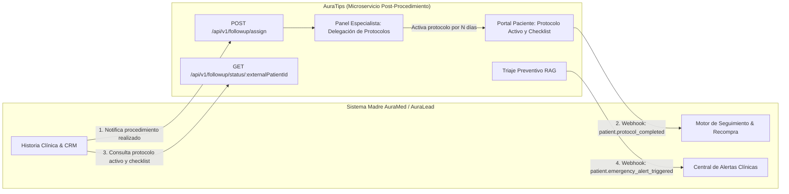

# Contrato de Integración: AuraTips con el Sistema Madre de AuraMed

Este documento define las especificaciones técnicas y el contrato de interfaz para la integración bidireccional entre el **Sistema Madre de AuraMed (AuraLead / EMR)** y **AuraTips** (Microservicio Especializado de Acompañamiento Post-Procedimiento).

---

## Filosofía Arquitectónica y Desacoplamiento



### Principios Clave
1. **Separación de responsabilidades:** AuraTips gestiona exclusivamente el acompañamiento post-procedimiento activo y la adherencia diaria. El historial médico completo y la gestión comercial de recompra pertenecen al Sistema Madre de **AuraMed**.
2. **Propiedad intelectual del protocolo:** Los protocolos clínicos de AuraMed tienen una vigencia definida (7, 14, 21 o 30 días). Una vez finalizado o caducado el periodo, el paciente conserva la constancia histórica del procedimiento realizado pero se revoca el acceso al contenido instructivo propietario.
3. **Comunicación bidireccional firmada:** AuraMed notifica los procedimientos realizados y consulta el avance activo; AuraTips emite webhooks firmados con `HMAC-SHA256` cuando un protocolo concluye o cuando se detecta una señal de alarma médica en el chat.

---

## Seguridad y Autenticación

### 1. Solicitudes entrantes (AuraMed → AuraTips)
Todas las solicitudes máquina a máquina (M2M) hacia `/api/v1/followup/*` requieren el token secreto de servicio en la cabecera HTTP:

```http
Authorization: Bearer <AURATIPS_SERVICE_SECRET>
Content-Type: application/json
```

### 2. Webhooks salientes (AuraTips → AuraMed)
AuraTips envía peticiones `POST` hacia la URL configurada en `AURATIPS_WEBHOOK_URL` firmando el cuerpo JSON con `AURATIPS_SERVICE_SECRET`:

```http
Content-Type: application/json
X-Auratips-Event: patient.protocol_completed | patient.emergency_alert_triggered
X-Auratips-Signature: sha256=<hmac_sha256_hex>
```

---

## Endpoints del Contrato

### Caso A.1 — Notificación de Procedimiento Realizado (AuraMed → AuraTips)

Permite a **AuraMed / AuraLead** notificar que un paciente acaba de finalizar un procedimiento en consultorio para que el especialista en AuraTips visualice la notificación y delegue operativamente el protocolo (o lo active de inmediato si se envía `"auto_activate": true`).

* **Método:** `POST`
* **Ruta:** `/api/v1/followup/assign`
* **Headers:**
  * `Authorization: Bearer <AURATIPS_SERVICE_SECRET>`
  * `Content-Type: application/json`

#### Payload de Entrada (`request body`):

```json
{
  "patient": {
    "external_id": "auramed-pac-84920",
    "full_name": "Ana Gómez",
    "email": "ana.gomez@ejemplo.com",
    "phone": "+57 300 123 4567"
  },
  "procedure": {
    "slug": "toxina-botulinica-botox-facial",
    "application_date": "2026-10-17T14:30:00Z",
    "doctor_name": "Especialista AuraMed",
    "clinic_location": "AuraMed Sede Principal",
    "treatment_notes": "Aplicación en tercio superior facial."
  },
  "auto_activate": false,
  "expires_after_days": 14
}
```

#### Respuesta Exitosa (`201 Created`):

```json
{
  "success": true,
  "followup_id": "not_eb1f24fb",
  "patient_id": "eb1f24fb-a432-4881-b703-a921e95892b6",
  "external_id": "auramed-pac-84920",
  "procedure_slug": "toxina-botulinica-botox-facial",
  "procedure_title": "Toxina Botulínica (Botox Facial)",
  "status": "pending_specialist_delegation",
  "expires_after_days": 14,
  "message": "Notificación de procedimiento recibida desde AuraMed. Lista para delegación por el especialista en AuraTips."
}
```

---

### Caso A.2 — Webhook de Cierre / Caducidad del Protocolo (AuraTips → AuraMed)

Cuando el protocolo activo del paciente cumple su ciclo de días (7, 14, 21 o 30 días) o es finalizado manualmente por el especialista en AuraTips, se emite este webhook hacia **AuraMed** indicando que el cuidado post-operatorio concluyó y el paciente está listo para seguimiento o recomendación de recompra.

* **Evento:** `patient.protocol_completed`
* **Headers:** `X-Auratips-Signature: sha256=...`

#### Payload Emitido (`webhook body`):

```json
{
  "event": "patient.protocol_completed",
  "timestamp": "2026-10-31T14:30:00Z",
  "patient": {
    "id": "eb1f24fb-a432-4881-b703-a921e95892b6",
    "external_id": "auramed-pac-84920",
    "full_name": "Ana Gómez",
    "email": "ana.gomez@ejemplo.com",
    "phone": "+57 300 123 4567"
  },
  "procedure": {
    "course_id": "c72e89bc-1234-4567-89ab-cdef01234567",
    "slug": "toxina-botulinica-botox-facial",
    "title": "Toxina Botulínica (Botox Facial)",
    "category": "Rejuvenecimiento Facial",
    "enrolled_at": "2026-10-17T14:30:00Z",
    "completed_at": "2026-10-31T14:30:00Z",
    "duration_days": 14
  },
  "closure_reason": "expired_automatically",
  "next_action_hint": "ready_for_followup_or_repurchase"
}
```

---

### Caso B — Consulta de Estado del Protocolo Activo y Checklist (AuraMed → AuraTips)

Permite a **AuraMed** consultar únicamente el estado del protocolo activo actual del paciente y su porcentaje de cumplimiento del checklist diario de cuidados (sin exponer historial clínico general).

* **Método:** `GET`
* **Ruta:** `/api/v1/followup/status/:externalPatientId`
* **Headers:** `Authorization: Bearer <AURATIPS_SERVICE_SECRET>`

#### Respuesta Exitosa (`200 OK`):

```json
{
  "external_id": "auramed-pac-84920",
  "patient_id": "eb1f24fb-a432-4881-b703-a921e95892b6",
  "patient_name": "Ana Gómez",
  "has_active_protocol": true,
  "active_protocol": {
    "course_id": "c72e89bc-1234-4567-89ab-cdef01234567",
    "procedure_slug": "toxina-botulinica-botox-facial",
    "procedure_title": "Toxina Botulínica (Botox Facial)",
    "enrolled_at": "2026-10-17T14:30:00Z",
    "current_day": 2,
    "remaining_days": 12,
    "expires_after_days": 14
  },
  "checklist_compliance_rate": "83%",
  "checklist_history": [
    { "day": 0, "stage_title": "Primeras 4 a 6 horas críticas", "completed": 3, "total": 3 },
    { "day": 1, "stage_title": "Primeras 24 a 72 horas", "completed": 2, "total": 3 }
  ]
}
```

---

### Caso C — Webhook de Alerta de Urgencia Clínica (AuraTips → AuraMed)

Si el paciente reporta en el asistente clínico de AuraTips un síntoma que activa el triaje de emergencia (ej. sospecha de compromiso vascular, dolor severo o fiebre), AuraTips presenta al paciente el botón de WhatsApp prioritario hacia la clínica y emite en paralelo el siguiente webhook externo hacia **AuraMed**:

* **Evento:** `patient.emergency_alert_triggered`
* **Headers:** `X-Auratips-Signature: sha256=...`

#### Payload Emitido (`webhook body`):

```json
{
  "event": "patient.emergency_alert_triggered",
  "timestamp": "2026-10-18T17:15:30Z",
  "patient": {
    "external_id": "auramed-pac-84920",
    "full_name": "Ana Gómez",
    "phone": "+57 300 123 4567"
  },
  "procedure_slug": "relleno-acido-hialuronico-labios",
  "recovery_day": 1,
  "urgency_level": "vascular_compromise",
  "matched_categories": ["vascular_compromise"],
  "user_message": "Tengo la piel blanca, fría y siento dolor intenso en el labio superior",
  "automated_actions_taken": [
    "Instrucción inmediata de reposo y no manipulación emitida al paciente",
    "Canal directo de WhatsApp prioritario hacia AuraMed presentado en el chat",
    "Webhook de alerta crítica transmitido al Sistema Madre de AuraMed"
  ]
}
```
